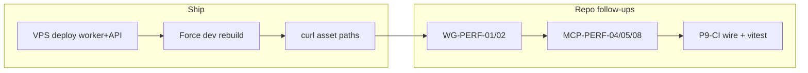

# Flow remediation Phase 9 — deep decomposition (2026-11-05)

**Parent:** [bus_mcp_log_remediation plan](../.cursor/plans/bus_mcp_log_remediation_7aca27ea.plan.md) (Phase 0–6) · Phase 8 [FLOW_REMEDIATION_PHASE8_LOG_20261105.md](./FLOW_REMEDIATION_PHASE8_LOG_20261105.md)

**Philosophy filter ([PHILOSOPHY_INDEX.md](../philosophy/PHILOSOPHY_INDEX.md)):**

| Pillar | Application in Phase 9 |
|--------|-------------------------|
| **Creation over Conflict** | One vite entry (`site-vite-build.mjs`), one build-target env helper (`apply_site_build_target_env`), one membership probe (planned MCP-PERF-04) — no nginx-only or second worker flag matrix |
| **Elegant Minimalism** | Throttle reconcile instead of new admin UI for queue; aliases instead of duplicate MCP tools; debug logs instead of second auth path |
| **Observability first** | Golden signals in runbook; `analyze_backend_log` signals; bus intake snapshot; CI guard on platform yaml |
| **0.4.26 AgentGit+AgentBus** | Journal → enqueue → worker env → preview URL chain must match bus messages and WG nodes |

**Genes (lookup via `platform_tooling.py genes explain -- <tag>`):**

- `core.hosting.bucket.gen1` — build queue, `site_build_service`, git hook target
- `core.mcp.self_description.gen1` — instruction atoms, `when_blocked`, describe wire vs `execute_budget`
- `core.agents.work_graph.gen1` — `work_next` compact/full, fleet_skipped, unit economics
- `repo.engineering.founder_direct_ship.gen1` — ship one code path; no founder canary duplication
- `repo.platform.unit_economics.gen1` — heavy `instruction_packet` on compact loop = cost leak

**Engineering patterns:** SOLID (single build contract) · DRY (shared atoms + one node script) · KISS (aliases, throttle) · ECS metaphor (job entity, worker system, env components)

---

## A. Already shipped in repo (this session)

### A.1 Dev preview base contract (G-01/G-02/G-03)

**Problem:** Worker built with Vite `base=/` while HTML served under `/s/{pid}/{bucket}--dev/`.

**Fix (Python — inject identity + target into worker env):**

```python
# shared/atoms/hosting_build.py
apply_site_build_target_env(
    env, build_target,
    project_id=project_id,
    bucket_name=bucket_id,
)
# sets HOSTING_BUILD_TARGET, AGENTSTACK_BUILD_TARGET, BUILD_TARGET,
# HOSTING_PROJECT_ID, HOSTING_BUCKET_NAME
```

**Fix (Node — read same env keys):**

```javascript
// agentstack-frontend/scripts/site-vite-build.mjs
const devBase = `/s/${pid}/${bucket}--dev/`;
// HOSTING_BUILD_TARGET in env loop alongside AGENTSTACK_BUILD_TARGET
```

**Why:** Runbook and Python both named `HOSTING_BUILD_TARGET` but script only listened to `AGENTSTACK_BUILD_TARGET`; hardcoded pid=1 broke tenant previews.

**Verify after VPS deploy:**

```bash
curl -s "https://agentstack.tech/s/1/frontend--dev/" | findstr /i assets
# expect: src="/s/1/frontend--dev/assets/...
```

**Tests:** `agentstack-core/tests/unit/test_site_build_service.py` (HOSTING_BUCKET_NAME assertion)

---

### A.2 Post-deploy script syntax (HOST-PS-02)

**File:** `agentstack-core/scripts/ensure_platform_frontend_dev_preview.py` line 124 — corrupted `el    if` → `elif`.

**CI step (add to deploy gate or prod atlas):**

```bash
python -m py_compile agentstack-core/scripts/ensure_platform_frontend_dev_preview.py
npm run audit:platform-shell-site-build
```

---

### A.3 Worker peek perf (HOST-PERF-06)

**File:** `hosting_site_build_queue.py` — `_maybe_reconcile_stale_bucket_indexes` at most every **45s** on `peek_pending_job`.

**Why:** Full `by_bucket/*.json` scan every 60s tick dominated worker CPU on large job dirs (KISS vs new index service).

---

### A.4 MCP self-description (G-09 + build status aliases)

**Files:**

- `agentstack-core/mcp/action_aliases.py` — `hosting.site.build.status` → `hosting.site.build_status` (+ poll/build.status)
- `shared/mcp/hosting_instruction_atoms.py` — platform shell narrative uses `site-vite-build.mjs`, not `--base ./` only
- `docs/operations/PLATFORM_SHELL_HOSTING_RUNBOOK.md` — build step corrected

**Regen after atoms change:**

```bash
python agentstack-core/scripts/gen_mcp_agent_instruction_index.py
npm run audit:mcp-instruction-contract
```

---

### A.5 Log / principal hygiene (partial MCP-PERF-05)

**File:** `mcp/current_user_context.py` — enrich probe `logger.info` → **debug** when ids missing (catalog/anonymous batches).

---

## B. VPS / ops (cannot close in monorepo alone)

| ID | Task | Steps | Owner |
|----|------|-------|-------|
| **P9-SHIP-01** | Deploy images with this commit | `deploy-from-windows.ps1` backend + **backend-worker**; confirm `AGENTSTACK_PROCESS_ROLE=worker` | Ops |
| **P9-OPS-02** | Unstick `b363816e` | Runbook §Worker queue → reconcile stale → `hosting.site.build` `target=dev` `force=true` | Ops |
| **P9-OPS-01** | Registry snapshot drift | `npm run audit:mcp-official-registry-readiness:live` — regen snapshot when tools_count stable | Ops |
| **P9-OPS-03** | `push-mcp-registry-auth-env.ps1` | VPS env + curl `/.well-known/mcp-registry-auth`; `plan_patch` close `arch-mcp-registry-auth` | Ops |

---

## C. Work graph + unit economics (WG-PERF)

### C.1 WG-PERF-01 — Fleet single-hop (P0 ROI)

**Symptom:** Compact `agents.work_next` → `blocked_reason_code=fleet_skipped` → client runs second call with `detail=full`.

**Where:**

- `shared/work_graph/plan_get_fleet_gate.py` — `work_next_request_needs_fleet`
- `shared/work_graph/execution_resolver.py` — `fleet is None` → `fleet_skipped`
- `shared/work_graph/work_next.py` — `_synthesize_compact_next_action` rewrites `next_action` with `detail=full`

**Fix (DRY — one gate, no new flag file):**

```python
# plan_get_fleet_gate.py — pseudocode
def work_next_request_needs_fleet(params, *, structural_rollup_has_executable_leaf: bool) -> bool:
    if params.get("detail") == "full" or params.get("claim"):
        return True
    if structural_rollup_has_executable_leaf and params.get("home") != "diagnose":
        return True  # load fleet once on compact when claim path implied
    return False
```

**Philosophy:** 0.4.23 — compact loop must not lie about cost; 0.4.22 — no second workflow engine.

**Test:** extend `shared/tests/test_work_next_next_action_invariant.py` — compact with executable leaf must not emit `detail=full`-only next_action when fleet load succeeds in same request.

---

### C.2 WG-PERF-02 — Heavy expand on compact (P0 ROI)

**Symptom:** `work_next_loop_wire_compact` recommends `recommended_expand.default: ["instruction_packet"]` while `execute_budget` marks `agents.work_next` cheap.

**Where:** `shared/work_graph/work_next.py` ~712–716; `work_next_needs_heavy_packet_build` ~653–659.

**Fix:**

```python
"recommended_expand": {
    "default": [],  # compact loop: no instruction_packet compile
    "detail_full_default": ["instruction_packet"],
    "when_state_blocked": ["instruction_packet", "blocked_work"],
    ...
}
```

**Sync:** `discovery.describe` wire for `agents.work_next` must match (self-describing tools gene).

**UI:** Copilot already shows `fleet_skipped` hint (`CopilotBlockedWorkPanel`); no duplicate banner.

---

### C.3 WG-PERF-03 — Plan graph revision cache

**Where:** `project_orchestrator_service.load_plan_graph` + `tools_agents._load_graph_for_home`.

**Fix:** When batch carries `if_match_revision` equal to prefetch stash, skip `read_project_data_path` for `ORCHESTRATOR_TASK_LIST_PATH`.

**DNA rule:** leaf read only — never `projects.patch_data` full blob (`dna_protein_data_plane` gene).

---

## D. MCP batch performance (MCP-PERF)

### D.1 MCP-PERF-04 — Membership once

**Merge** `work_graph_membership_error_code`, `membership_role`, `ensure_mcp_l1_caps` into one request-scoped helper using `find_one_json_leaf` + existing `_membership_role_cache`.

**File targets:** `shared/projects/project_membership_gate.py`, `mcp/current_user_context.py`, `shared/mcp/gate_caps_membership.py`.

---

### D.2 MCP-PERF-05 — Slim principal hydrate

**Where:** `controller.py` `hydrate_mcp_execute_principal` + `execute_batch_needs_membership_hydrate` (`shared/mcp/bitmap_session_reconcile.py`).

**Rule:** If JWT already has `effective_project_role` + service caps bitmap and batch is read-only spine, skip `enrich_current_user_from_api_key`.

---

### D.3 MCP-PERF-08 — Batch prepare unify

**Where:** `_prepare_execute_batch_ingress` vs per-step `assert_batch_mutation_preflight`.

**Fix:** Scan all steps once for expand/fleet/plan_claim needs; attach to batch context; skip redundant preflight on read-only work-graph recipes.

---

### D.4 MCP-PERF-09/10 — Observability + describe parity

- **get_dev_index:** Client batch **step id** only — correlate `action=` in same log line (`controller.py` already logs both). Add analyzer hint in `analyze_backend_log.py` output.
- **MCP-PERF-10:** Align `shared/mcp/execute_budget.py` `WORK_GRAPH_CONTROL_PLANE_ACTIONS` with `work_next_loop_wire_compact` (after WG-PERF-02).

---

## E. Relay + messenger (non-blocking)

| ID | Task | File | Note |
|----|------|------|------|
| **P9-RELAY-01** | Quiet cross-worker WARN | `social_chat_relay_bridge.py` | PG bus already ships; rate-limit + gene heat |
| **P9-MSG-01** | DB-IDX10 + U.0 | `docs/SOCIAL_CHAT_RELAY_BACKLOG.md` | Scheduled rows added |

---

## F. CI / audits (expand)

| Script | Purpose |
|--------|---------|
| `npm run audit:platform-shell-site-build` | **Added** — yaml must reference `site-vite-build.mjs` |
| `npm run bus:intake-snapshot` | Refresh `docs/_generated/bus_intake_latest.json` |
| Pending **P9-CI-02** | Node test file `agentstack-frontend/scripts/__tests__/site-vite-build.resolveBase.test.mjs` |

**Wire P9-CI-01:**

```json
"audit:hosting-shell-contract": "npm run audit:platform-shell-site-build && python -m pytest agentstack-core/tests/unit/test_site_build_service.py -q"
```

---

## G. Plugin / skills DRY (P9-DOC-01)

Update identical paragraphs in:

- `provided_plugins/cursor-plugin/plugins/agentstack/skills/agentstack-hosting/SKILL.md`
- `provided_plugins/claude-plugin/skills/agentstack-hosting/SKILL.md`
- `provided_plugins/vscode-plugin/skills/agentstack-hosting/SKILL.md`

Replace item 6 “`npx vite build --base ./` only” with:

> Platform shell: `node scripts/site-vite-build.mjs` + worker env `HOSTING_BUILD_TARGET`. Tenant journals: same script or `./` base per golden path G10.

---

## H. Gap register extension (G-16–G-20)

| ID | Gap | Fix |
|----|-----|-----|
| **G-16** | Script ignored `HOSTING_BUILD_TARGET` env key | **Fixed** in `site-vite-build.mjs` |
| **G-17** | Hardcoded `/s/1/frontend--dev/` | **Fixed** via HOSTING_PROJECT_ID/BUCKET_NAME |
| **G-18** | `ensure_platform_frontend_dev_preview` SyntaxError | **Fixed** |
| **G-19** | Stale MCP/hosting copy `--base ./` for platform | **Partial** — atoms+runbook; regen index + skills pending |
| **G-20** | Compact work_next unit economics | **Open** — WG-PERF-01/02 |

---

## I. Execution order (recommended)



1. **P9-SHIP-01** + **P9-OPS-02** (unblock preview)
2. **WG-PERF-02** then **WG-PERF-01** (halve plugin MCP cost)
3. **MCP-PERF-04/05** (DNA + logs)
4. **P9-DOC-01** regen + skills
5. **WG-PERF-03**, **RELAY-PERF-07**, **P9-CI-02** (ROI gated)

---

## J. Verification matrix

| Check | Command |
|-------|---------|
| Build env unit | `python -m pytest agentstack-core/tests/unit/test_site_build_service.py -q` |
| Platform yaml | `npm run audit:platform-shell-site-build` |
| MCP aliases | `python -m pytest agentstack-core/tests/mcp/test_mcp_tool_resolution.py::test_canonical_mcp_action_helpers -q` |
| Hosting gene scope | `npm run test:scope -- --gene core.hosting.bucket.gen1` |
| Work graph invariants | `npm run test:scope -- --gene core.agents.work_graph.gen1` |
| Closed loop fast | `npm run audit:closed-loop-harness:fast` |
| Live preview | `curl` index.html asset prefix (post-deploy) |
| Bus intake | `npm run bus:intake-snapshot` |

---

## K. Anti-patterns (Phase 9)

| Wrong | Right |
|-------|-------|
| nginx `sub_filter` for asset paths | Worker env + `site-vite-build.mjs` |
| Second vite entry in platform_shell yaml | `node scripts/site-vite-build.mjs` |
| `detail=full` as default for all copilot polls | Compact + targeted expand after claim |
| Ack bus mail for other handles | Read SOP in `BOT_OWNER_AGENT_MESSAGE_BUS.md` |
| Full orchestrator blob patch for plan fix | `plan_patch` CAS + leaf paths |

---

*End Phase 9 decomposition — implement pending TODOs in priority order; do not bump version without explicit founder order (`no-version-bump` rule).*
